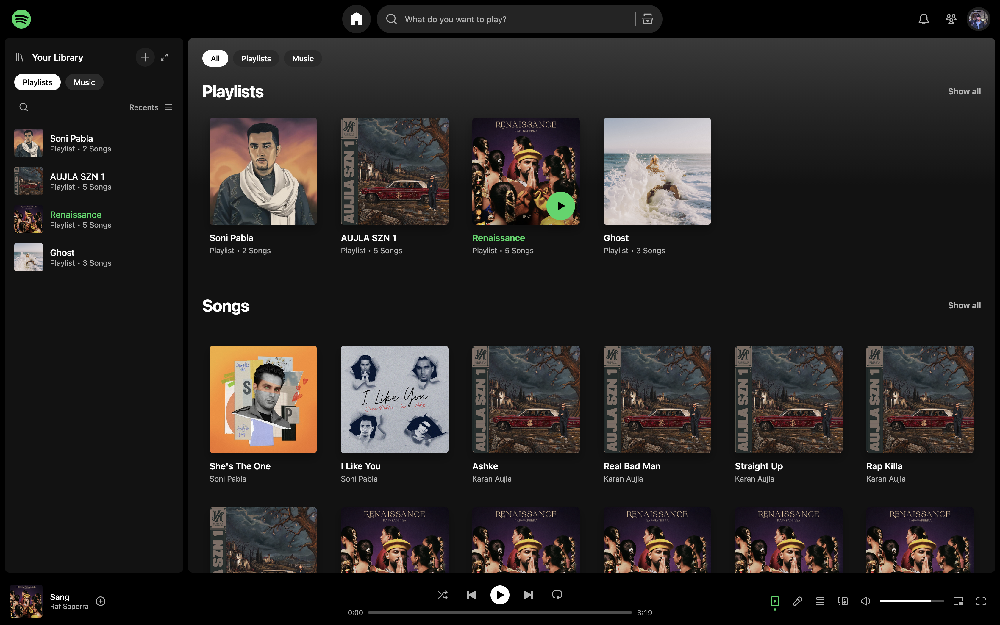
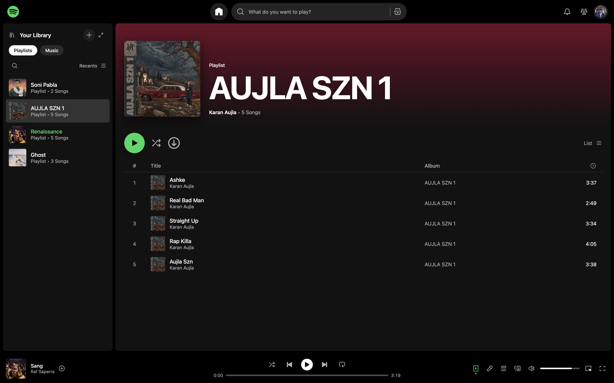
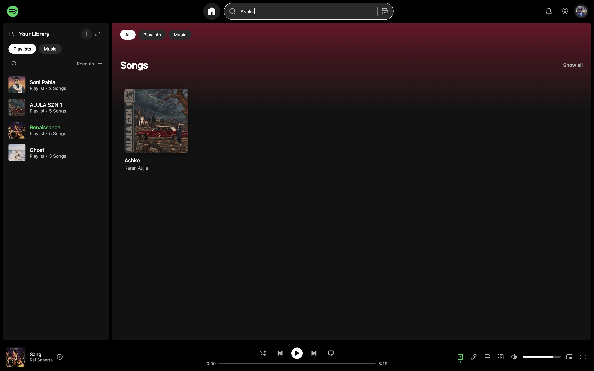

<h1 align="center">Spotify Clone</h1>
<p align="center">A responsive music player inspired by Spotify, built with plain HTML, CSS and JavaScript.</p>


## Screenshots
<p align="center">
  
</p>

<table align="center">
  <tr>
    <td align="center">
      <br>
      <sub>Playlist page with shuffle</sub>
    </td>
    <td align="center">
      <br>
      <sub>Live search</sub>
    </td>
  </tr>
</table>


## Features
- **Home page** with playlist cards and song cards, and filter chips (All, Playlists, Music)
- **Playlist page** with a gradient header in the playlist's own colour, a play button, a shuffle button and a track table
- **Player bar:** play and pause, next and previous, shuffle, repeat (off, all, one), a seek bar, volume and mute
- **Playback speed** from 0.5x to 1.5x, with the pitch kept the same
- **A-B loop** to repeat any section of a song: click once to set the start, again to set the end, and a third time to clear it. The looped section is shown in green on the seek bar
- **Saved settings:** the last song, volume, shuffle, repeat and speed are remembered in the browser (`localStorage`) and restored when the page is reopened
- **Search** that filters playlists and songs as you type
- **Your Library sidebar** listing playlists and songs, with filters and an expand button
- **Colour tint:** hovering over a playlist or song changes the colour at the top of the home page to match that playlist
- **Real song lengths** read from the audio files
- **Highlight** of the playing song in cards, rows and the sidebar, with an animated equaliser
- **Responsive layout** for desktop and tablet screens
- **SVG sprite** icons that stay sharp at any size

> Some buttons, such as download, queue, lyrics, device and create playlist, are only part of the design and do not do anything yet.


## Built with
- HTML5 (semantic tags, `<template>` for pages)
- CSS3 (variables, Flexbox, Grid, media queries)
- JavaScript (DOM, events, the browser Audio API, `localStorage`)
- Poppins font


## Project structure
```
Spotify/
├── index.html          page structure, icon sprite and view templates
├── css/
│   └── styles.css      theme, layout and responsive styles
├── js/
│   ├── data.js         songs and playlists
│   ├── player.js       audio engine, player bar and saved settings
│   └── app.js          pages, navigation, sidebar and search
└── assets/
    ├── audio/          MP3 files (not included, see below)
    ├── fonts/          Poppins
    └── img/            covers, avatar and screenshots
```


## How to run
1. Download or clone the repository:
```bash
   git clone https://github.com/Shobit27/Spotify-Clone.git
   cd Spotify-Clone
```
2. Add your own MP3 files to `assets/audio/` (see below).
3. Open `index.html` in a browser, or start a local server:
```bash
   python3 -m http.server 8000
```
   and visit `http://localhost:8000`.

Use a recent version of Chrome, Edge, Safari or Firefox. The hover colour tint uses newer CSS (`@property` and `color-mix()`) and will not show in older browsers.


## Audio files
The MP3 files are **not included** because the songs are copyrighted. Create the folder `assets/audio/` and add files named `track-1.mp3` to `track-15.mp3`, matching the `src` paths in `js/data.js`. The project comes with 4 playlists and 15 songs.


## Adding a song or playlist
1. Copy the audio file to `assets/audio/` and the cover to `assets/img/`.
2. In `js/data.js`, add a new object to `TRACKS` with a unique `id`, `title`, `artist`, `album`, `src` and `cover`.
3. Add that `id` to a playlist's `trackIds` list.
4. To add a playlist, add a new object to `PLAYLISTS` with an `id`, `title`, `owner`, `cover`, a header `color` and its `trackIds`. Home, sidebar and the playlist page update automatically.

File names are case-sensitive on GitHub Pages and Linux, so keep the names in `data.js` exactly the same as the files.


## How it works
- `data.js` stores all the content, and a playlist stores only song ids. A hidden "All Songs" playlist holds every song.
- `player.js` keeps the player state (current playlist, song, shuffle, repeat, speed) and plays audio with the browser's `Audio` object. Every change redraws the player bar and saves the settings to `localStorage`.
- `app.js` copies the Home or Playlist template into the main area, fills it from the data, and handles search, navigation and highlighting. The address (`#/playlist/...`) decides which page is shown.


## Future improvements
- Phone layout for screens below 480 px
- User login and sign-up
- Music from an online API
- Liked songs and custom playlists
- Lyrics and a play queue
- Working download, queue and create-playlist buttons


## Disclaimer
This is an educational project. It is not affiliated with Spotify. Song titles, artwork and audio belong to their respective owners.


## Author
**Shobit Suman**, B.Tech Information Technology, GNDEC Ludhiana