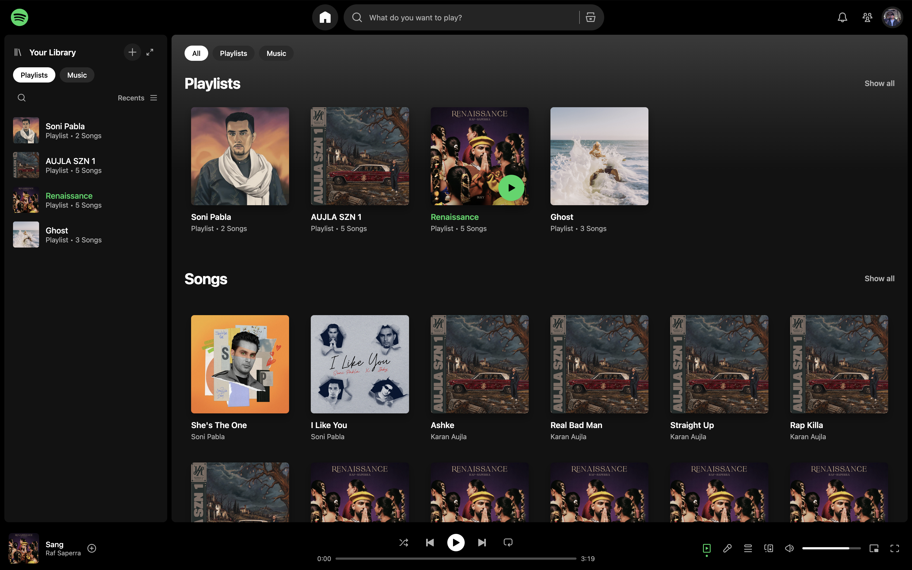
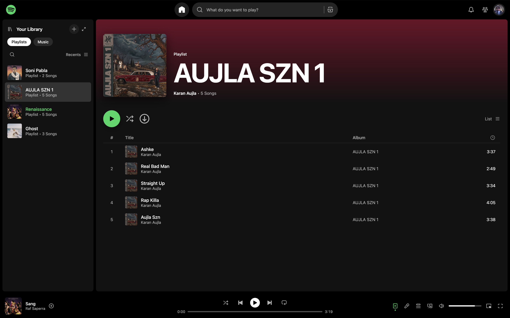
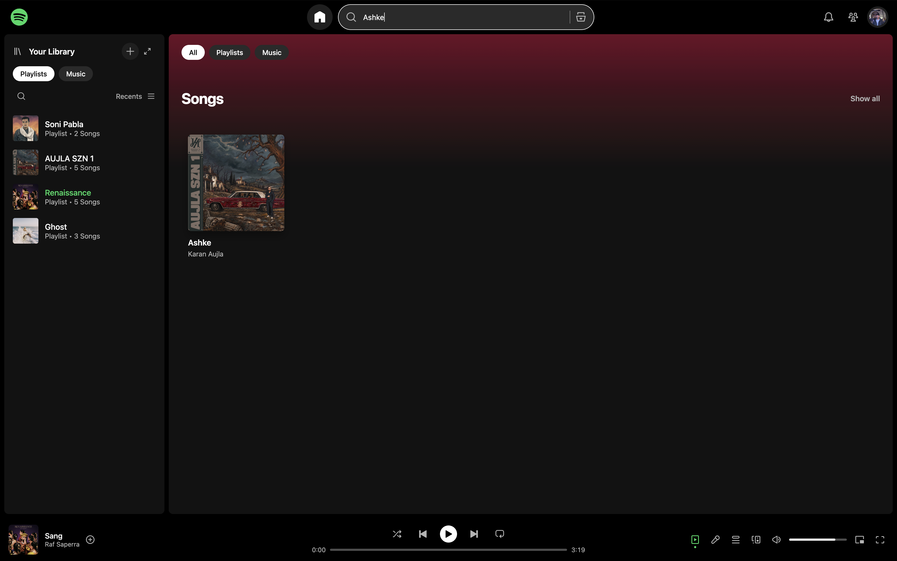

# Spotify Clone
<h1 align="center">Spotify Clone</h1>
<p align="center">A responsive music player inspired by Spotify, built with plain HTML, CSS and JavaScript.</p>


## Screenshots
<p align="center">
  
</p>

<table align="center">
  <tr>
    <td align="center">
      <br>
      <sub>Playlist page with shuffle</sub>
    </td>
    <td align="center">
      <br>
      <sub>Live search</sub>
    </td>
  </tr>
</table>


## Features
- **Home page** with playlist cards and song cards, and filter chips (All, Playlists, Music)
- **Playlist page** with a gradient header, a play button, a shuffle button and a track table
- **Player bar:** play and pause, next and previous, shuffle, repeat (off, all, one), a seek bar, volume and mute
- **Search** that filters playlists and songs as you type
- **Your Library sidebar** listing playlists and songs, with filters
- **Real song lengths** read from the audio files
- **Highlight** of the playing song in cards, rows and the sidebar
- **Responsive layout** for desktop and tablet screens
- **SVG sprite** icons that stay sharp at any size


## Built with
- HTML5 (semantic tags, `<template>` for pages)
- CSS3 (variables, Flexbox, Grid, media queries)
- JavaScript (DOM, events, the browser Audio API)
- Poppins font


## Project structure
```
Spotify/
├── index.html          page structure, icon sprite and view templates
├── css/
│   └── styles.css      theme, layout and responsive styles
├── js/
│   ├── data.js         songs and playlists
│   ├── player.js       audio engine and player bar
│   └── app.js          pages, navigation, sidebar and search
└── assets/
    ├── audio/          MP3 files (not included, see below)
    ├── fonts/          Poppins
    └── img/            covers and avatar
```


## How to run
1. Download or clone the repository:
```bash
   git clone https://github.com/Shobit27/Spotify-Clone.git
   cd Spotify-Clone
```
2. Add your own MP3 files to `assets/audio/` (see below).
3. Open `index.html` in a browser, or start a local server:
```bash
   python3 -m http.server 8000
```
   and visit `http://localhost:8000`.


## Audio files
The MP3 files are **not included** because the songs are copyrighted. Create the folder `assets/audio/` and add files named `track-1.mp3`, `track-2.mp3` and so on, matching the `src` paths in `js/data.js`.


## Adding a song or playlist
1. Copy the audio file to `assets/audio/` and the cover to `assets/img/`.
2. In `js/data.js`, add a new object to `TRACKS` with a unique `id`, `title`, `artist`, `album`, `src` and `cover`.
3. Add that `id` to a playlist's `trackIds` list. To add a playlist, add a new object to `PLAYLISTS`.


## How it works
- `data.js` stores all the content, and a playlist stores only song ids.
- `player.js` keeps one state (current playlist, song, shuffle, repeat) and plays audio with the browser's `Audio` object.
- `app.js` copies the Home or Playlist template into the main area and fills it from the data.


## Future improvements
- Phone layout for screens below 480 px
- User login and sign-up
- Music from an online API
- Liked songs and custom playlists
- Saving the last played song and volume


## Disclaimer
This is an educational project. It is not affiliated with Spotify. Song titles, artwork and audio belong to their respective owners.


## Author
**Shobit Suman**, B.Tech Information Technology, GNDEC Ludhiana